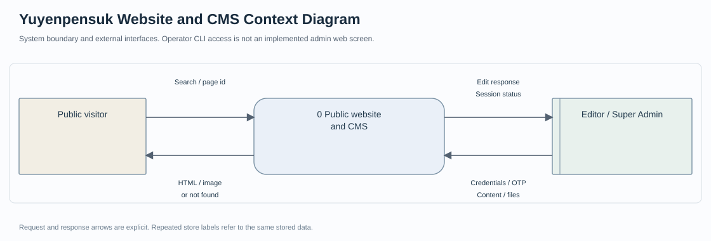
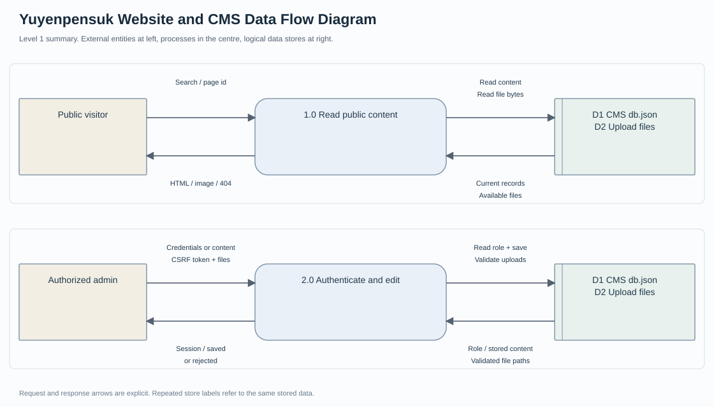
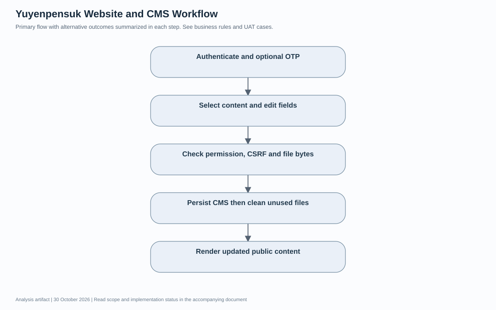
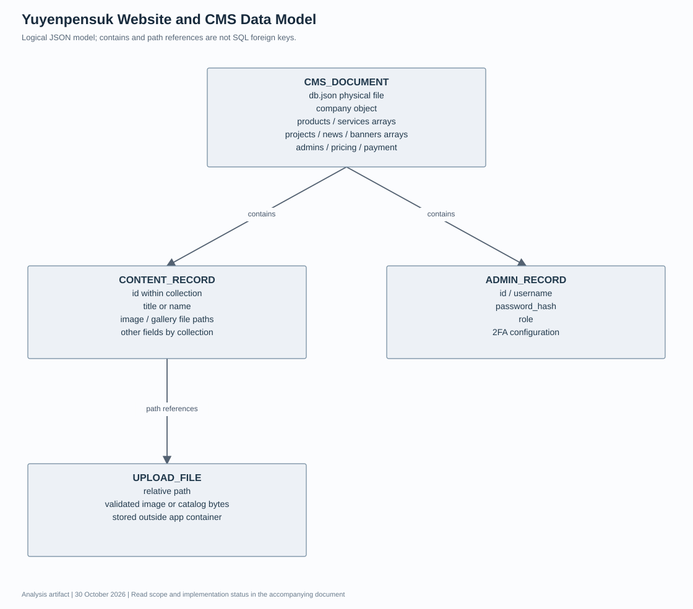

# Yuyenpensuk Website and CMS เอกสารวิเคราะห์ความต้องการและออกแบบระบบ

รุ่นเอกสาร 1.0 · วันที่ 30 October 2026 · ผู้จัดทำ Panupong Intasan โดยใช้ AI assistance ใน ChatGPT Work

ให้ผู้สนใจเปิดดูข้อมูลบริษัท สินค้าและบริการ และให้ทีมงานปรับเนื้อหาผ่าน CMS โดยไม่ต้องแก้หน้าเว็บด้วยตนเอง โครงสร้างปัจจุบันเป็นเว็บบริษัทและระบบจัดการเนื้อหา ไม่ใช่ระบบ checkout หรือบริหารงานติดตั้งครบวงจร

**สถานะเอกสาร:** จัดทำใหม่จากการอ่านโค้ด ณ commit `f3d52d949649cb190f92496092bc6b0dc6739541` เพื่ออธิบายระบบและใช้ตรวจรับ ไม่ใช่บันทึกการสัมภาษณ์หรือหลักฐานว่าผู้มีส่วนได้ส่วนเสียอนุมัติ Requirement แล้ว รายการที่ยังต้องตัดสินใจอยู่ในหัวข้อคำถามยืนยัน

[อ่านฉบับเว็บบน Portfolio](https://intasan.github.io/portfolio/analysis/yuyenpensuk/index.html) · [ไฟล์ HTML](analysis.html) · [Diagram source](diagrams/)

## 1 เป้าหมาย ผู้ใช้งาน และขอบเขต

| ผู้เกี่ยวข้อง | หน้าที่ |
| --- | --- |
| ผู้เข้าชม | ค้นหาสินค้า อ่านบริการ ผลงาน ราคาและช่องทางติดต่อ |
| Editor | เข้าสู่ระบบและจัดการเนื้อหาตาม route ที่อนุญาต |
| Super Admin | จัดการเนื้อหาและบัญชีผู้ดูแล |
| ผู้ดูแลเซิร์ฟเวอร์ | ติดตั้ง สำรอง db.json และ uploads ดูแล hostname และ HTTPS |

**อยู่ในขอบเขต:** Public website, CMS สำหรับบริษัท สินค้า บริการ ข่าว ผลงาน banner ราคา payment instructions และบัญชีผู้ดูแล

**อยู่นอกขอบเขต:** ตะกร้าสินค้า รับชำระอัตโนมัติ Stock ledger ใบเสนอราคา CRM นัดช่าง และหลักฐานรับรองว่างานติดตั้งตัวอย่างเกิดขึ้นจริง

## 2 วิธีเก็บและยืนยันความต้องการ

เอกสารรอบนี้ใช้ source review, schema review และผลทดสอบที่มีอยู่เป็น input ข้อกำหนดแบบ As implemented ใช้อธิบายพฤติกรรมที่พบในโค้ด ส่วน To be เป็นข้อเสนอหรือคำถามที่ยังไม่ได้อนุมัติ ไม่มีการสร้างชื่อผู้ให้สัมภาษณ์ วันประชุม หรือผลลงนามย้อนหลัง

กระบวนการยืนยันที่เสนอคือให้ผู้ใช้งานหลักทบทวน scope และ Business Rules จากนั้นเดินผ่าน scenario ปกติและข้อผิดพลาด บันทึกคำตอบพร้อมผู้ตัดสินใจ แล้วปรับ version ของ Requirement และ UAT ก่อนรับรองการใช้งานจริง

## 3 Functional Requirements และเกณฑ์ยอมรับ

ทุกแถวต่อไปนี้เป็น **As implemented จากโค้ด** คอลัมน์หลักฐานแยกสิ่งที่มีการทดสอบเดิมกับสิ่งที่เพียงพบใน source การจัดทำเอกสารไม่ได้ทำให้ผลทดสอบที่ยังรออยู่กลายเป็นผ่าน

| รหัส | ความต้องการ | เกณฑ์ยอมรับ | Source | หลักฐานหรือสถานะ |
| --- | --- | --- | --- | --- |
| Y-FR01 | แสดงเว็บสาธารณะจากข้อมูล CMS | อ่านข้อมูลปัจจุบันก่อน render และแสดงหน้า public โดยไม่ต้อง login | server.js | พบในโค้ด |
| Y-FR02 | ค้นสินค้าและกรองยี่ห้อ | กรอง q หรือ brand และเปิดรายละเอียด id ที่มีอยู่ | routes/site.js | พบในโค้ด |
| Y-FR03 | อ่านแกลเลอรีจากไฟล์ local | ส่งเฉพาะรูปที่หาได้จริงใน uploads และคืน 404 เมื่อไม่มี binary | utils/product-images.js | ต้องทดสอบกับ uploads จริง |
| Y-FR04 | ยืนยันตัวตนผู้ดูแล | ตรวจรหัสผ่านที่ hash และ OTP หากบัญชีเปิด 2FA | routes/admin.js | พบในโค้ด ยังไม่ทดสอบ end to end ในรอบนี้ |
| Y-FR05 | จำกัดหน้าจัดการบัญชี | requireSuperAdmin ปฏิเสธ Editor ด้วย 403 | middleware/auth.js | พบในโค้ด |
| Y-FR06 | เพิ่มแก้ลบเนื้อหา CMS | รับข้อมูลผ่าน authenticated CRUD และบันทึก db.json | routes/admin.js | ต้องทดสอบ CRUD ในข้อมูลแยก |
| Y-FR07 | ตรวจไฟล์อัปโหลดและ CSRF | ตรวจขนาด ชนิดและ magic bytes; ปฏิเสธ token ที่ไม่ตรง session | routes/admin.js | พบในโค้ด ต้องทดสอบไฟล์ผิดชนิด |
| Y-FR08 | คงข้อมูลหลัง deploy ใหม่ | ใช้ DATA_DIR และ UPLOAD_DIR ภายนอก container; โหลด db เดิมโดยไม่ seed ทับ | database.js | ต้องทดสอบ restart บน volume แยก |
| Y-FR09 | แยก public และ admin ด้วย hostname | deploy-server.js เลือก app ตาม host ที่กำหนด | deploy-server.js | ต้องทดสอบ routing / proxy |
| Y-FR10 | ป้องกันลบรูปก่อนบันทึกข้อมูลสำเร็จ | persist ก่อน cleanup และ rollback object หาก save ล้มเหลว | routes/admin.js | พบในโค้ด ต้องทดสอบ fault injection |

## 4 Business Rules

1. seed ใช้เฉพาะเมื่อไม่มี db.json เดิม รายการ CMS ที่มีอยู่เป็นข้อมูลหลัก
2. รูปและฐานข้อมูลอยู่คนละที่ ต้องสำรองเป็นชุดที่สอดคล้องกัน
3. Editor ไม่ได้มีสิทธิ์จัดการบัญชีผู้ดูแล; Super Admin ต้องผ่าน requireAuth ด้วย
4. ข้อมูล projects และข้อความการตลาดที่ seed มาไม่ใช่หลักฐานยืนยันลูกค้าหรือสถิติการส่งมอบ
5. Production บังคับ SESSION_SECRET และรหัสเริ่มต้นที่ตรงเงื่อนไข พร้อม HTTPS; dev preview ไม่เปิด app admin

## 5 Non Functional Requirements

| รหัส | ประเด็น | เกณฑ์และสถานะ |
| --- | --- | --- |
| yuyenpensuk-NFR01 | Data integrity | ใช้การตรวจสอบ input และการบันทึกที่สอดคล้องกับ business rules; ดูข้อจำกัดรายโครงการด้านล่าง |
| yuyenpensuk-NFR02 | Access control | ตรวจสิทธิ์ที่ server ตาม actor และ endpoint; ไม่อ้างสิทธิ์ที่ระบบยังไม่มี |
| yuyenpensuk-NFR03 | Observability | ต้องอธิบาย error / unavailable และ provenance ที่มีอยู่; audit trail แบบสมบูรณ์ยังไม่ถือว่ามี |
| yuyenpensuk-NFR04 | Usability | เสนอให้ทดสอบ desktop และ mobile ตั้งแต่ 360 px พร้อม keyboard; ยังไม่มีผลตรวจครบทุกขนาด |
| yuyenpensuk-NFR05 | Performance | ยังไม่มี SLA ที่ผู้เกี่ยวข้องอนุมัติ ต้องกำหนดจำนวนผู้ใช้และเกณฑ์ response time ก่อน load test |
| yuyenpensuk-NFR06 | Recovery | เสนอให้ทดสอบสำรองและกู้คืนข้อมูลพร้อมไฟล์ที่สัมพันธ์กัน; RPO/RTO ยังต้องตกลง ไม่กำหนดตัวเลขแทนผู้ใช้ |

## 6 Context Diagram

อ่านร่วมกับ [Mermaid context source](diagrams/context.mmd) ซึ่งแสดงข้อมูลขาเข้าและขาออกแยกทิศทาง Context Diagram กำหนดขอบเขตระบบทั้งก้อน ไม่แสดง data store ภายใน

## 7 Data Flow Diagram และทะเบียนข้อมูล

ภาพ SVG เป็น process overview แบบย่อ ส่วน [DFD Mermaid source](diagrams/data-flow.mmd) และทะเบียนด้านล่างแสดงทิศทาง request/response และ data store อย่างละเอียด ห้ามตีความลูกศรเป็นลำดับเวลาดำเนินงานอย่างเดียว

| Flow | ต้นทาง | ปลายทาง | ข้อมูลที่ส่งไป | ข้อมูลตอบกลับ |
| --- | --- | --- | --- | --- |
| D01 | Visitor | 1.0 Public content | ค้นหา brand/id/หน้าเนื้อหา | HTML หรือ 404 |
| D02 | 1.0 Public content | D1 CMS / D2 Uploads | อ่านข้อมูลและไฟล์ที่อ้างอิง | เนื้อหาและ bytes ที่มีอยู่จริง |
| D03 | Admin | 2.0 CMS | credentials/OTP หรือ content + CSRF + uploads | session ผลบันทึก redirect หรือ error |
| D04 | 2.0 CMS | D1 CMS | อ่านสิทธิ์และบันทึกเนื้อหา | ข้อมูลปัจจุบันหรือ save error |
| D05 | 2.0 CMS | D2 Uploads | ตรวจและเขียนไฟล์; cleanup หลัง persist | validated paths หรือ file error |

## 8 Workflow

1. ผู้ดูแลเข้าสู่ระบบและ OTP หากเปิดใช้
2. เลือกประเภทเนื้อหาและกรอกข้อมูล
3. ตรวจสิทธิ์ CSRF และไฟล์
4. บันทึก db.json แล้วจัดการรูปที่ไม่อ้างอิง
5. ผู้เข้าชมเปิดข้อมูลที่อัปเดต

ข้อผิดพลาดต้องส่งผลตาม Requirement ที่เกี่ยวข้องและไม่ข้ามการตรวจสิทธิ์หรือความถูกต้องของข้อมูล [แก้ไข Mermaid workflow](diagrams/workflow.mmd)

## 9 Data Model และ Data Dictionary

นี่เป็นแบบจำลองเชิงตรรกะของข้อมูล JSON และไฟล์ ไม่มี SQL table หรือ FK บังคับความสัมพันธ์

| Entity หรือ data store | ข้อมูลหลัก |
| --- | --- |
| CMS_DOCUMENT | db.json physical file; company object; products / services arrays; projects / news / banners arrays; admins / pricing / payment |
| CONTENT_RECORD | id within collection; title or name; image / gallery file paths; other fields by collection |
| ADMIN_RECORD | id / username; password_hash; role; 2FA configuration |
| UPLOAD_FILE | relative path; validated image or catalog bytes; stored outside app container |

| Parent | Child | Relationship |
| --- | --- | --- |
| CMS_DOCUMENT | CONTENT_RECORD | contains |
| CMS_DOCUMENT | ADMIN_RECORD | contains |
| CONTENT_RECORD | UPLOAD_FILE | path references |

[Mermaid data model source](diagrams/data-model.mmd)

## 10 UAT และ Requirement Traceability

ตารางนี้เป็น test design และ mapping กับหลักฐานที่มี การผ่าน unit/API test ไม่เท่ากับผู้ใช้ปลายทางลงนาม UAT

| Test ID | Requirement | ขั้นตอนหรือ input | ผลคาดหวัง | สถานะหลักฐาน |
| --- | --- | --- | --- | --- |
| Y-UAT01 | Y-FR02 | ค้น model หรือเลือก brand | รายการตรงเงื่อนไข รายการว่างต้องไม่ error | รอตรวจรับ |
| Y-UAT02 | Y-FR04 Y-FR05 | Editor เปิดหน้าจัดการ admins | 403 และไม่แก้บัญชี | รอตรวจรับ |
| Y-UAT03 | Y-FR07 | อัปโหลดไฟล์นามสกุลภาพแต่ bytes ไม่ใช่ภาพ | ปฏิเสธและไม่ทิ้งไฟล์กำพร้า | รอตรวจรับ |
| Y-UAT04 | Y-FR06 Y-FR08 | แก้สินค้า restart แล้วเปิดใหม่ | คงค่าที่บันทึกและรูปเปิดได้ | รอตรวจรับ |
| Y-UAT05 | Y-FR10 | ทำให้ save ล้มเหลวในข้อมูลทดสอบ | ค่าก่อนหน้าและรูปอ้างอิงยังอยู่ | รอตรวจรับ |
| Y-UAT06 | Y-FR09 | เปิด host public / admin / host ไม่อนุญาต | แยก app ถูกต้องและปฏิเสธ host อื่น | รอตรวจรับ |

**ผู้ตรวจรับ:** ยังไม่กำหนด · **วันที่ตรวจรับกับผู้ใช้:** ยังไม่ดำเนินการในรอบเอกสารนี้ · **ผลลงนาม:** ยังไม่มี

## 11 ข้อจำกัดและความเสี่ยง

- แบบจำลองข้อมูลในเอกสารนี้เป็น logical model ของ JSON ไม่ใช่ SQL ERD และไม่มี foreign key constraint
- browser รอบก่อนพบปัญหา CSS จาก CSP ใน HTTP dev; แก้แล้วและ header tests ผ่าน 2 กรณี แต่ยังไม่มีภาพหลังแก้ที่ตรวจรับแล้ว
- ยังไม่มีรูป uploads ของเครื่องใช้งานจริงใน checkout; ไม่ควรรับรองแกลเลอรีจากโค้ดเพียงอย่างเดียว

## 12 คำถามที่ต้องยืนยันก่อนขยายระบบ

1. ใครอนุมัติเนื้อหาและราคาแต่ละประเภทก่อนเผยแพร่
2. ต้องมี draft และ approval workflow หรือ publish ทันทีแบบปัจจุบัน
3. รูปสินค้าใดมีสิทธิ์เผยแพร่ และใครดูแลข้อมูลรุ่น/ราคา
4. ต้องเก็บ audit trail ของผู้แก้ไขเนื้อหาและระยะเวลาย้อนคืนเท่าไร
5. ต้องสำรองทุกกี่ชั่วโมง และยอมรับการสูญหายข้อมูล/เวลาหยุดระบบได้เท่าไร

## 13 Source Baseline และประวัติเอกสาร

- [database.js](https://github.com/intasan/yuyenpensuk-website/blob/f3d52d949649cb190f92496092bc6b0dc6739541/database.js)
- [routes/site.js](https://github.com/intasan/yuyenpensuk-website/blob/f3d52d949649cb190f92496092bc6b0dc6739541/routes/site.js)
- [routes/admin.js](https://github.com/intasan/yuyenpensuk-website/blob/f3d52d949649cb190f92496092bc6b0dc6739541/routes/admin.js)
- [middleware/auth.js](https://github.com/intasan/yuyenpensuk-website/blob/f3d52d949649cb190f92496092bc6b0dc6739541/middleware/auth.js)
- [deploy-server.js](https://github.com/intasan/yuyenpensuk-website/blob/f3d52d949649cb190f92496092bc6b0dc6739541/deploy-server.js)
- [tests/security-headers.test.js](https://github.com/intasan/yuyenpensuk-website/blob/f3d52d949649cb190f92496092bc6b0dc6739541/tests/security-headers.test.js)

| Version | วันที่ | รายการเปลี่ยนแปลง |
| --- | --- | --- |
| 1.0 | 30 October 2026 | จัดทำ requirement catalogue, data flow register, diagrams, data dictionary และ UAT traceability จาก source baseline |

เอกสารวิเคราะห์และไดอะแกรมเป็น deliverable ใหม่ ไม่ใช่ภาพหน้าจอหรือหลักฐานผลการทำงานที่ยังไม่ได้ทดสอบ ไม่มีการอ่านหรือแก้ repository ที่ผู้ใช้ระบุให้ยกเว้น
